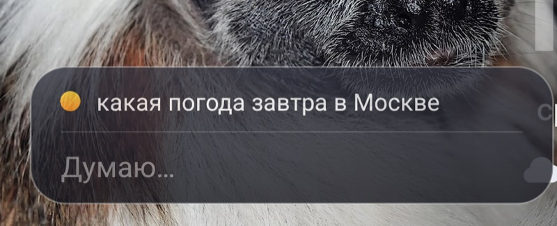
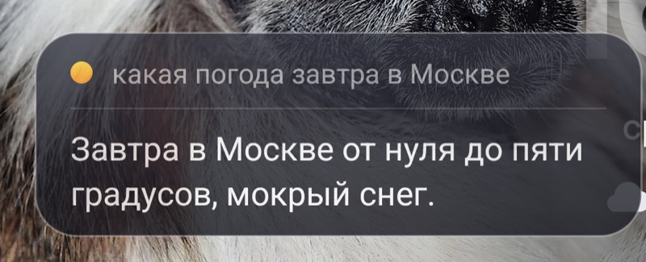
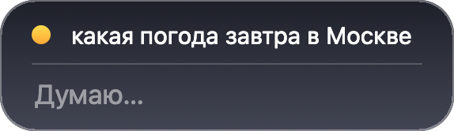

# Боб

Домашний голосовой ассистент для телевизора на Google TV и для Мака. Откликается на кодовое слово,
отвечает на вопросы, включает Яндекс Музыку. Речь распознаётся и озвучивается у вас дома, на Маке.

| | слушает | думает | отвечает |
|---|:---:|:---:|:---:|
| **ТВ** |  |  |  |
| **Мак** |  |  |  |

Запрос появляется на плашке по мере речи, ниже ответ. Плашка одинаковая на ТВ и на Маке и показывается
поверх любых окон, фильм при этом не прерывается.

## Что умеет

- **Откликается на кодовые слова** «Боб», «Миньон», «Подручный», «Окей, Сбер». Каждое говорит своим голосом.
- **Отвечает на вопросы:** время, погода в любом городе, расчёты, свежие факты из интернета.
- **Играет Яндекс Музыку:** «включи Земфиру», «Мою волну», пауза, дальше, громче, лайк. Играет и при выключенном ТВ.
- **Помнит:** «запомни, что собаку зовут Бублик».
- **Принимает уточнения** без кодового слова: после ответа несколько секунд слушает продолжение.
- **Ставит фильм на паузу** на время разговора и сам включает экран ТВ.
- **Голос включается и выключается отдельно** для каждого устройства: «Боб, отвечай только текстом».

## Как устроено

```
 ТВ (приложение)  ─┐                    ┌─ кодовое слово → речь в текст
 Мак (приложение) ─┼─ звук ──▶ Мак ─────┤─ модель с инструментами (время, погода, поиск, музыка)
                   │         (сервер)   └─ голос
                   ◀── плашка, голос, музыка ──┘
```

Вся логика на Маке. ТВ и Мак: устройства с микрофоном, динамиком и плашкой. Отвечает то, которое услышало.
Модель подключается через адаптер (локальная в Ollama, Claude, любая OpenAI-совместимая).

## Состояние

| | |
|---|---|
| Разговор на Маке: слово, речь, ответ, голос | ✅ |
| Память, поиск в интернете | ✅ |
| Приложение для ТВ, плашка | 🔨 работает, ждёт проверки голосом с дивана |
| Приложение для Мака | 🔨 плашка и меню, микрофон пока в сервере |
| Яндекс Музыка | 🔨 работает, ждёт проверки голосом |
| Умный дом, управление ТВ, справка «что умеешь» | ⬜ |

Подробно: [docs/plan.md](docs/plan.md).

## Запуск

```sh
# сервер на Маке
cd server && uv sync && uv run bob

# приложение для Мака
cd mac-app && ./build.sh && open build/Bob.app

# приложение для ТВ (сборка и установка по ADB)
cd tv-app && ./gradlew assembleRelease
```

Нужны [uv](https://docs.astral.sh/uv/), [Ollama](https://ollama.com) с моделью `qwen3:30b-instruct` и Java 17 для ТВ.
Подробности: [server](server/README.md), [mac-app](mac-app/README.md), [музыка](docs/music.md).

## Документация

[План](docs/plan.md) · [Плашка](docs/plate.md) · [Музыка](docs/music.md) · [Токен Яндекс Музыки](docs/yandex-music-token.md) ·
[Разведка ТВ](docs/recon-tv.md) · [Решения](docs/decisions.md)
