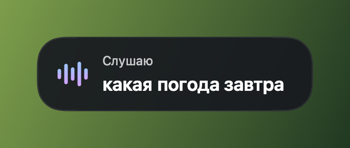
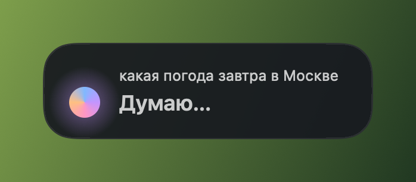
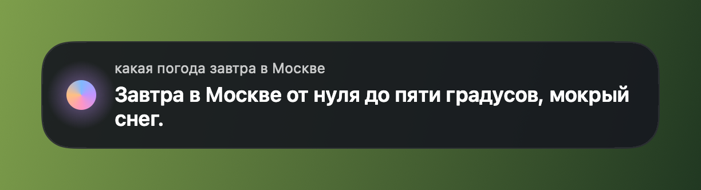
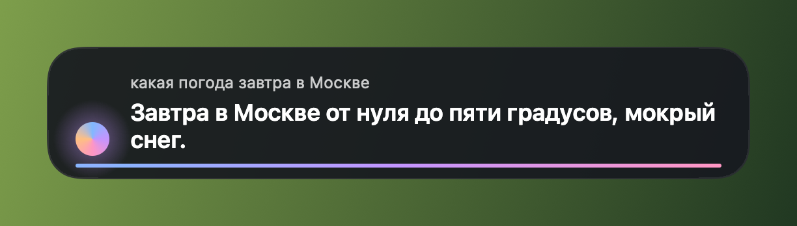
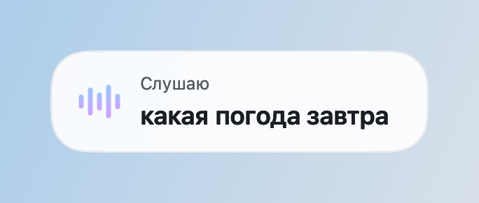
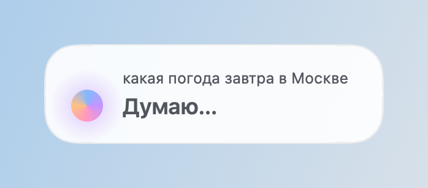
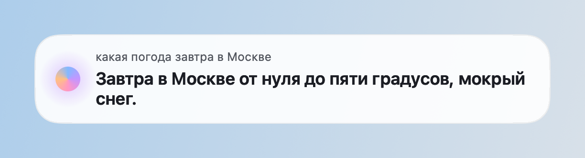
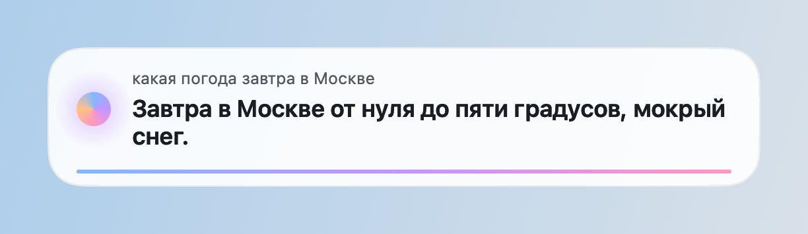

# Плашка

Одна плашка для всех устройств. Сервер шлёт её состояние, ТВ и Мак рисуют одинаково.

| | слушает | думает | отвечает | можно уточнить |
|---|:---:|:---:|:---:|:---:|
| **тёмная** |  |  |  |  |
| **светлая** |  |  |  |  |

## Фазы

| Фаза | Что видно | Индикатор слева |
|---|---|---|
| `listening` | мелко «Слушаю», крупно запрос, который заполняется по словам | звуковые полоски |
| `thinking` | мелко запрос, крупно «Думаю…» | вращающийся орб |
| `answer` | мелко запрос, крупно ответ | орб «дышит» |
| `followup` | то же и тонкая полоска, убывающая за время окна уточнения | орб «дышит» |
| `idle` | плашка скрыта | |

## Темы

Две темы: **тёмная** (по умолчанию) и **светлая**. Тема хранится для каждого устройства отдельно
(`server/data/devices.json`) и меняется голосом:

- «Боб, светлая тема», «тёмная тема», «поставь светлую плашку»
- «Боб, смени тему», «переключи плашку» (переключает на другую)

У Мака тему можно сменить ещё и в меню приложения. Ответ на команду уже показывается в новой теме.

## Как она работает

- **Живой запрос.** После кодового слова второй распознаватель Vosk (без списка слов) разбирает речь по ходу
  и присылает частичный текст не чаще 8 раз в секунду. Итог для ответа даёт whisper, он точнее.
- **Показ только после подтверждения слова.** Плашка и пауза плеера включаются, когда в частичном тексте
  встретилось кодовое слово. Если whisper потом не подтвердил, плашка гаснет, а «idle» шлёт только тот
  слушатель, который её показывал.
- **Голос и плашка вместе.** Если голос включён, ответ звучит и показывается. Если выключен, показывается
  только плашка, и она остаётся дольше (по длине ответа, не меньше окна уточнения). В режиме «только текст»
  Боб молчит полностью: без голоса и без сигнала «слушаю».
- **Голос настраивается для каждого устройства отдельно.** Команды: «Боб, отвечай только текстом»
  (также «выключи голос», «без голоса») и «Боб, отвечай голосом» («включи голос», «говори голосом»).

## Компоновка без прыжков

Карточка растёт вверх от нижнего края, а значок привязан к нижней строке текста, поэтому он не двигается, когда
добавляются слова или строки. Подпись «Слушаю» и подсказка «Говорите…» занимают место с самого начала, а полоска
окна уточнения рисуется в нижнем поле и высоту не меняет. Проверка: `BobMac --layout` печатает высоту и положение значка
для каждой фазы (расстояние от значка до нижнего края должно быть одинаковым).

## Протокол (WebSocket, JSON)

Сервер → устройство:

```json
{"type": "plate", "phase": "followup", "request": "какая погода", "answer": "Завтра снег", "voice": true, "theme": "dark", "window": 8}
{"type": "media", "hold": true}
{"type": "settings", "voice": false, "theme": "light"}
```

`window` — длина окна уточнения в секундах (для убывающей полоски).
Устройство-экран (Мак) → сервер: `{"type": "set_voice", "enabled": false}`, `{"type": "set_theme", "theme": "light"}`.
Приветствие экрана: `{"type": "hello", "role": "display", "device": "mac", "token": "..."}`.

## Вид

Материал без размытия фона (на ТВ приложение не видит картинку под собой, поэтому и на Маке его нет):
почти непрозрачная карточка (тёмная `#121318` или белая), скругление около 30, без рамки: мягкая тень и еле заметный светлый край.
Слева орб с конусным градиентом (голубой, фиолетовый, розовый, оранжевый) и мягким свечением. Запрос мелким приглушённым
шрифтом, ответ крупным полужирным. Вместо линии-разделителя отступ. Размеры на ТВ в dp (`Overlay.java`, `IndicatorView.java`),
на Маке в pt (`Look.swift`, `Indicator.swift`, `PlateView.swift`).

**Ничего не прыгает при смене числа строк (Mac).** Орб закреплён на первой строке крупного текста, строка запроса всегда занимает своё место, даже пустая.
Окно закреплено верхним краем и растёт вниз: верх стоит на высоте плашки в четыре строки (`Look.reservedLines`) над нижним краем экрана,
поэтому орб остаётся на одном месте на экране. На ТВ (`Overlay.java`) пока по-старому: орб по последней строке, плашка растёт вверх.

## Проверка без звука

```sh
uv run bob plate-demo tv                 # или mac
uv run bob plate-demo mac --theme light  # светлая тема
uv run bob plate-demo tv --slow 3        # медленно, чтобы успеть снять экран
```

Демонстрация шлёт только картинку: ни звука, ни команд плееру. Снимки для документации делает
`mac-app/build/Bob.app/Contents/MacOS/BobMac --snapshots <папка>`.

**Эквалайзер.** При «слушаю» орб заменяют пять полосок. Вариант `classic` — сине-фиолетовый градиент, `colorful` — каждая полоска своего цвета из палитры орба, с разным ритмом. Настройка `indicator` для каждого устройства, на Маке есть пункт меню и голосовая команда.
